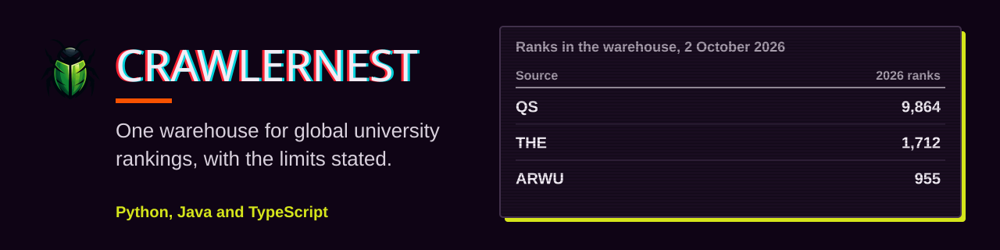
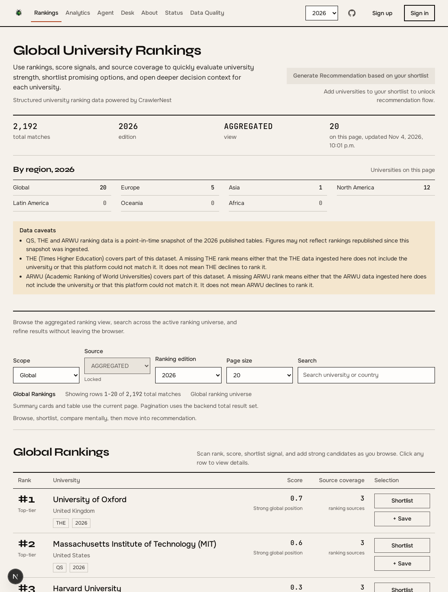
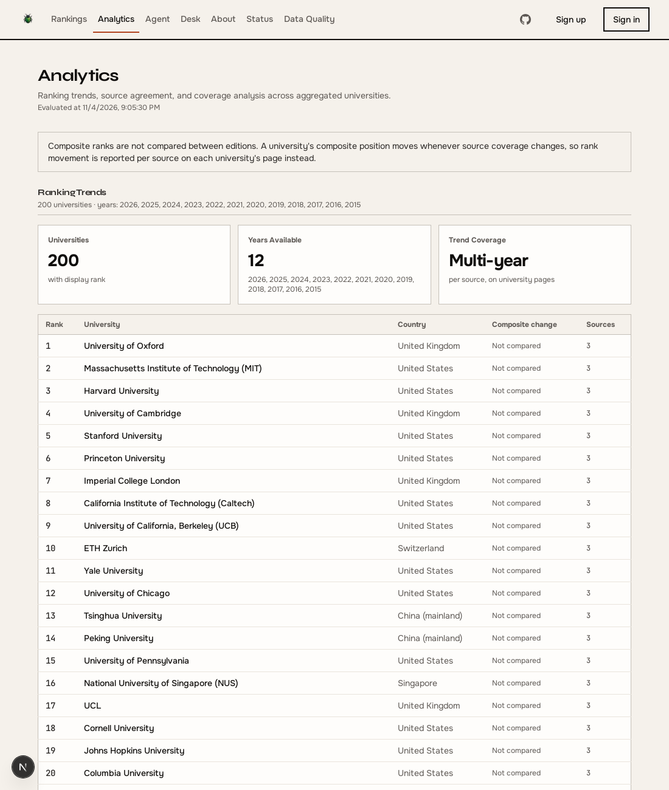
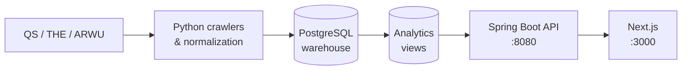
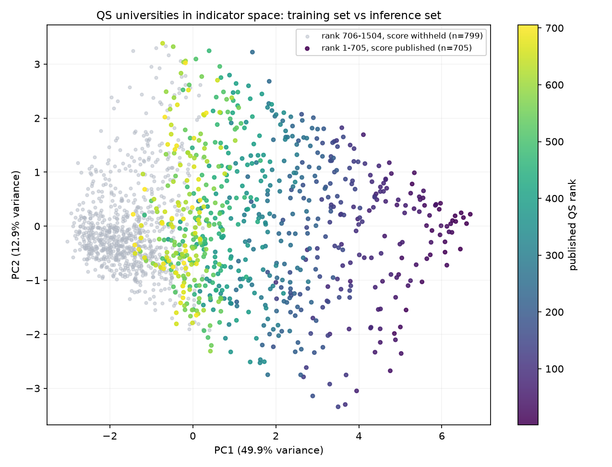

<p align="center">
  <picture><source media="(prefers-color-scheme: dark)" srcset="docs/assets/images/crawlernest-banner-dark.svg"></picture>
</p>

# CrawlerNest

**English** · [繁體中文](README.zh-TW.md)

> One warehouse for global university rankings from QS, THE and ARWU, with the limits of the data stated.

[](https://github.com/heinricitorgau/University-Data-Infrastructure-Web-Platform/actions/workflows/agent-tests.yml)
[](https://github.com/heinricitorgau/University-Data-Infrastructure-Web-Platform/actions/workflows/ml-tests.yml)
[](https://github.com/heinricitorgau/University-Data-Infrastructure-Web-Platform/actions/workflows/data-quality.yml)
[](https://github.com/heinricitorgau/University-Data-Infrastructure-Web-Platform/actions/workflows/release-smoke.yml)
[](https://github.com/heinricitorgau/University-Data-Infrastructure-Web-Platform/actions/workflows/api-tests.yml)
[](https://github.com/heinricitorgau/University-Data-Infrastructure-Web-Platform/actions/workflows/python-tests.yml)

An end-to-end university data infrastructure and web platform. It aggregates global and subject rankings from QS, THE, and ARWU into a single warehouse, exposes an explainability-first API, and delivers a Next.js frontend for browsing, comparing, and saving universities.

The system is data-first: crawlers and pipelines write canonical records into PostgreSQL, and the UI reads only from analytics views — never directly from raw tables.

---

## Contents

- [What It Does](#what-it-does)
- [What it looks like](#what-it-looks-like)
- [Architecture](#architecture)
- [Modelling layer](#modelling-layer)
- [Repository Layout](#repository-layout)
- [Getting Started](#getting-started)
- [Documentation](#documentation)
- [Continuous Integration](#continuous-integration)
- [Current State](#current-state)
- [License](#license)

---

## What It Does

- **Multi-source rankings** — 1,499 universities with all three sources ingested: QS 1,499, THE 1,080, ARWU 686
- **Subject rankings** — QS 2026 subject data for Computer Science, Electrical Engineering, Business & Management
- **Explainability** — every ranking and recommendation comes with a source comparison, confidence level, and evidence chain
- **Recommendations** — filter universities by region, rank tier, and subject; export a named plan
- **Analytics** — year-over-year rank movement, cross-source disagreement, data quality diagnostics
- **Modelling** — a feature layer over the nine QS indicators, with the withheld
  `Overall Score` of ranks 601–1503 as a supervised target
- **Identity layer** — session-based accounts, saved universities, saved recommendation plans

---

## What it looks like

The rankings browser, reading 2,192 aggregated universities for the 2026
edition out of the warehouse:



The analytics page, where the honesty contract is visible rather than just
documented — the notice at the top says composite ranks are not compared
between editions (movement is reported per source on each university's page),
and every row shows how many of the three ranking bodies actually contributed:



Both captured from a local run against the real database, not mockups.

---

## Architecture



**Tech stack:** Python · PostgreSQL · Spring Boot (Java 17) · Next.js (React) · Tailwind CSS

---

## Modelling layer

QS publishes nine component indicators for all 1,504 universities in the 2026
edition, but the `Overall Score` only for ranks 1–705. That asymmetry is a
supervised learning problem sitting in the data:

```
rank    1– 705  →  score published   →    705 labelled rows  (training set)
rank  706–1504  →  score withheld    →    799 unlabelled rows (inference set)
```

Exploratory analysis of that split produced the finding that shapes the whole
modelling design:



PC1 alone explains 49.9% of the variance and orders the labelled universities
almost monotonically by rank. But the 799 universities we would predict pile up
at the low end of PC1, where training data is sparse — every indicator differs
between the two groups by 0.55 to 1.78 pooled standard deviations. **Predicting
the withheld scores is extrapolation, not interpolation.**

So the model does not get to report a flattering cross-validated error and call
it accuracy. Cross-validation measures how well it recovers QS's scoring
function; a per-prediction support flag decides which estimates are publishable;
and Spearman correlation against the published ranks of the 799 provides the
only external validation available in the shifted region — the scores are
unknown there, but the ordering is not.

Two results came out of it:

**The published weighting is recoverable from the data.** A linear fit on the
raw indicators reproduces QS's documented weighting to a mean absolute error of
0.0011 — Academic Reputation 0.3007 against a published 0.30, Citations per
Faculty 0.1984 against 0.20, and so on across all nine. That makes this system
identification rather than forecasting, and the resulting R² of 0.9996 is
reported as "the formula was recovered", not as predictive accuracy.

**Preprocessing mattered more than the model.** Median imputation scores
Spearman 0.9381 against the published ranks of the 799. Renormalising over the
available indicators instead moves that to 0.9614 — with the fitted weights or
with QS's published ones, which land in the same place — so the gap is the
missing-value strategy, not the weights. Median imputation borrows values from a
training distribution whose medians run up to nearly six times higher than the
withheld tail, and it was the out-of-distribution check that first caught it.

Estimates are stored and labelled as estimates. Nothing in the modelling layer
writes to `analytics.aggregated_rankings` or changes a published rank, and 45%
of the inference set is flagged as outside the model's support.

All of these figures come from the edition-verified QS 2026 table (nid 4061771).
The snapshot committed before 2026-09-14 was the 2027 table saved under the 2026
name; see [crawlernest-ml/README.md](crawlernest/crawlernest-ml/README.md#the-data).

**A second question, asked of the historical editions: does a university's next rank
depend on more than its last one?** For every university a source ranks in two
consecutive editions, the next printed band is predicted from the band before it, the
edition before that, and what the other sources printed — fitted only on earlier
editions, scored against the *printed band* rather than a point. It is written in
MATLAB first, with an independent Python re-implementation of its deterministic half
checked against it at 1e-9. The answer is small and uneven: a least-squares model beats
"stay where you were" for ARWU (6,457 pairs) and THE (9,541) by about 4% and 9% of the
error, with intervals that exclude zero, and nothing learned beats it for QS (6,440),
where one edition (2023) accounts for the loss. It does not improve how
often the printed band is hit, and an error of 0.022 in log10 rank is about 5% of the
rank. It is not a forecasting model, and it says nothing causal. Results, the
publication-timing rule that keeps the experiment from using a number that did not yet
exist, and the limits:
[crawlernest-ml/matlab/README.md](crawlernest/crawlernest-ml/matlab/README.md#cross-edition-forecast).

→ **[crawlernest/crawlernest-ml/](crawlernest/crawlernest-ml/)** — feature
contract, EDA, metrics, and model cards.

---

## Repository Layout

```
README.md, README.zh-TW.md, LICENSE
crawlernest/                  the application
  crawlernest-web/            Next.js frontend
  crawlernest-camofox-client/ TypeScript client for camofox-browser (port 9377), its snapshot parser, and a Claude browsing agent
  servise_for_java/           Spring Boot API
  crawlernest-core/           canonical resolution, aggregation
  crawlernest-ml/             feature layer, EDA, and models over the QS indicators
  crawlernest-tests/          the Python test suite (run_tests.py, plus admission_pytest/)
  pipeline/                   CLI entry points
  packages/                   Python crawler packages, imported by their own names:
    crawlernest_ranking_crawler/    ranking ingestion
    crawlernest_admission_crawler/  admission ingestion
    crawlernest_crawler_core/       shared crawler logger
    legacy/                         archived earlier agent code, not maintained
  requirements.txt, requirements-ml.txt
docs/                         architecture, operations, release docs (docs/releases/ holds the release bundles)
scripts/                      startup, smoke checks, operational automation; git hooks in scripts/hooks/
deploy/                       Dockerfile, docker-compose files, systemd units, .env.example
```

Only the two READMEs and the licence sit at the top level; everything else is in one of the four folders. Hidden files
that git and GitHub require there (`.github/`, `.gitignore`, `.gitattributes`) stay, and the project's instructions for
Claude Code are in `.claude/CLAUDE.md`.

---

## Getting Started

**Prerequisites**

| Dependency | Version |
|---|---|
| Python | 3.11+ |
| PostgreSQL | 14+ |
| Java JDK | 17 |
| Node.js | ≥ 20.9 |
| Maven | bundled via `mvnw` |

First-time setup (fresh clone → runnable, one command):

```bash
./scripts/setup_from_scratch.sh
```

The script creates the Python venv, installs dependencies, starts PostgreSQL
(local install or Docker via `deploy/docker-compose.postgres.yml`), bootstraps the
schema, runs the first data crawl, and installs frontend dependencies. It is
idempotent — re-run it after fixing whatever it reports.

Then start everything:

```bash
./scripts/start_localhost.sh
```

→ **[docs/GETTING_STARTED.md](docs/GETTING_STARTED.md)** — the same steps done
manually, plus subject rankings and troubleshooting.

### Run your own data

**This repository ships with no ranking data.** Every deployment crawls its
own data directly from the ranking sources:

```bash
./.venv/bin/python -m crawlernest.run_pipeline run \
  --limit 20 --ranking-year 2026 \
  --pg-user test --pg-password test --pg-database clawer
```

- Crawling is polite by default: **10 seconds between requests** (tune with
  `--request-delay`, but stay respectful). Check the source site's
  `robots.txt` and terms of use before increasing crawl volume.
- If a live fetch fails, the pipeline falls back to your most recent local
  snapshot under `crawlernest/crawlernest-kb/` (snapshots are created on each
  successful run and are not committed to git).
- The crawl writes staging → warehouse → analytics; the UI reads only
  analytics views. Re-running is safe and idempotent per year/source.

---

## Documentation

| Topic | Doc |
|-------|-----|
| Architecture | [docs/ARCHITECTURE_OVERVIEW.md](docs/ARCHITECTURE_OVERVIEW.md) |
| Repository map | [docs/REPOSITORY_MAP.md](docs/REPOSITORY_MAP.md) |
| Data flow | [docs/DATA_FLOW.md](docs/DATA_FLOW.md) |
| API surface | [docs/API_SURFACE.md](docs/API_SURFACE.md) |
| Operational runbook | [docs/operational/OPERATIONAL_RUNBOOK.md](docs/operational/OPERATIONAL_RUNBOOK.md) |
| Auth limitations | [docs/AUTH_LIMITATIONS.md](docs/AUTH_LIMITATIONS.md) |
| Local troubleshooting | [docs/LOCAL_TROUBLESHOOTING.md](docs/LOCAL_TROUBLESHOOTING.md) |
| Local LLM (ds4) | [docs/DS4_LOCAL_MODEL.md](docs/DS4_LOCAL_MODEL.md) — natural-language answers for recommendation, ranking, lookup, and data-query tasks via a local or remote ds4 model (env config, remote host + SSH-tunnel/auth setup) |
| All docs | [docs/README.md](docs/README.md) |

---

## Continuous Integration

Nine workflows, thirteen jobs. What each one is worth depends on whether it can fail,
so that is what this table records rather than a list of names.

| Workflow | What it actually executes |
|---|---|
| **Agent Tests** | 285 tests over the web-agent generation layer, then the faithfulness eval across all 57 golden cases. Both mechanical verification signals — the faithfulness rules and the provenance/absence/completeness checker — are scored as detectors, with false positives on clean text reported separately from recall. |
| **ML Tests** | Three jobs. Feature-layer invariants and a metrics regression gate that retrains both models from the committed snapshot and fails on a real drop. A serving job that writes predictions to a throwaway PostgreSQL, verifies the rows, then *scores* them against the published data each target can be checked against — rank order for the estimated scores, observed disagreement for the probabilities. A MATLAB job that installs MATLAB, re-executes the ports and the cross-edition forecast, and compares the fresh output both against Python and against the committed artifacts (for the forecast, only the deterministic columns: the boosted model and the bootstrap depend on the MATLAB version). The committed forecast artifacts are also checked against Python on every push, with no MATLAB. |
| **Python Tests** | Two jobs. Fixture mode with no services, and a PostgreSQL job that runs the opt-in database tests — the aggregation maths, source-weight consistency, the superseded-row prune, ingest idempotency, and the world-ranking scope of the detail and convergence previews. The fixture job also runs the pytest-style admission crawler tests. Also runs weekly on a schedule, because one failure here was caused by time passing rather than by a commit. |
| **API Tests** | The Spring Boot suite against a real PostgreSQL service, 259 tests, with the surefire reports uploaded as artifacts. Each integration class creates the tables and views it reads, because the service database starts empty and a test that relied on another class having run first passed locally and failed here. |
| **Release Smoke** | Two jobs. Build artefacts — Java compile, Next.js build, Python syntax, readonly fixtures — and an analytics-bridge job that bootstraps PostgreSQL, seeds six universities, runs the warehouse→analytics bridge twice, starts Spring Boot, and checks that `/api/v1/rankings` serves what was written, followed by the endpoint liveness checks. |
| **Release Snapshot** | Restores every release in `docs/releases/` into an empty PostgreSQL (a matrix over the releases) and checks it against its `manifest.json`: ranks per source and edition, aggregated rows per edition and scope, the row counts a release depends on, the dump's checksum, and that it holds no user rows (v0.2's manifest records that its dump does). |
| **Warehouse Validation** | Nightly, on demand, and when a release or a warehouse-derived export changes. Restores the newest release, then runs the drift gate (the committed exports against it) and the whole Python suite with the database tests on and `CRAWLERNEST_REQUIRE_WAREHOUSE=1`, so a check that would skip on an empty database fails instead. When the exports differ, it lists those changed since the release was built: either cut a release from the warehouse they came from, or the export is wrong. |
| **Data Quality** | Validates the golden regression dataset and the CI fixture files, then runs the ranking-regression and failure-summary runners in fixture mode — no database, no network. |
| **Camofox Client Tests** | Runs only when `crawlernest/crawlernest-camofox-client/` or its workflow changes. Strict `tsc`, then 46 unit tests of the camofox-browser client, the snapshot parser, cookie and trace handling, and the Claude browsing agent: request shapes, which failures are retried, snapshot parsing, Netscape cookie files, and that the agent never acts on a ref missing from the latest snapshot. The tests stub `fetch`, the browser and the model; no browser server or API call runs, so they say nothing about a live camofox-browser or the Claude API. |

Two things this deliberately does *not* claim:

- **A skip is not a pass.** Several of these checks used to skip silently — the
  PostgreSQL tests had no database, the API endpoint checks had no server, the
  MATLAB sources were never re-executed. Each now runs somewhere that cannot skip
  it, and the jobs that legitimately skip say so in their names. The three files derived
  from the warehouse (`cross_edition_ranks.csv`, `qs_the_pairing_2026.json`, the alias
  files) used to be the exception: the fast jobs bootstrap an empty database. They are
  now held against the newest release by **Warehouse Validation**, and locally against
  the live warehouse by `./scripts/check_warehouse_drift.sh`, run by a pre-push hook
  (`./scripts/install_git_hooks.sh`, once per clone). A release is a frozen warehouse,
  so CI can say the exports match *the release*; only the local gate can say they match
  the warehouse as it is today.
- **Green means the checks ran, not that the system is correct.** The gaps that
  remain are recorded as limits in
  [`crawlernest-ml/README.md`](crawlernest/crawlernest-ml/README.md), not hidden
  behind a passing badge.

The full local suite, including the opt-in PostgreSQL tests:

```bash
CRAWLERNEST_RUN_PG_TESTS=1 CRAWLERNEST_PG_PASSWORD=test \
  python3 crawlernest/crawlernest-tests/run_tests.py
```

---

## Current State

CrawlerNest v0.1 is an operational MVP — reproducible and demonstrable, not a production deployment.

- All three ranking sources are ingested for 2026: QS covers 1,502 universities, THE 1,712, ARWU 955, across a global universe of 2,240
- 610 universities reach three sources (confidence high), 709 reach two, and 921 remain single-source (low)
- Historical editions are held too: THE and ARWU for every edition 2015–2026; QS for 2016, 2018–2020 and 2022–2024, recovered from Internet Archive captures of QS's own data files (pinned by hash, each load reversible) with `rank` stored as the lower bound of the printed rank, and disclosed by a caveat of their own. QS has no 2015, 2017 or 2021
- Coverage is partial, not complete — 528 universities carry no THE rank and 1,285 carry no ARWU rank. Every 2026 ranking record now resolves to a canonical university, so what remains is snapshot scope rather than unmatched entities
- Model estimates are stored separately and never enter `analytics.aggregated_rankings`: 787 estimated overall scores (351 of them outside the model's training support, and disclosed as such) and 1,483 disagreement probabilities, from the edition-verified QS 2026 snapshot
- A missing rank is disclosed as **our** gap — not ingested, or not matched — rather than as the source declining to rank the university
- The agent page defaults to a mock provider and does not write to the database

Release notes: [docs/release/RELEASE_NOTES_v0.1.md](docs/release/RELEASE_NOTES_v0.1.md)

---

## License

[Apache License 2.0](LICENSE).

The ranking data this platform ingests belongs to QS, Times Higher Education and
ShanghaiRanking, and is not covered by that licence. The committed snapshots are
here so the pipeline and the models are reproducible; anything you publish from
them is subject to each source's own terms.
