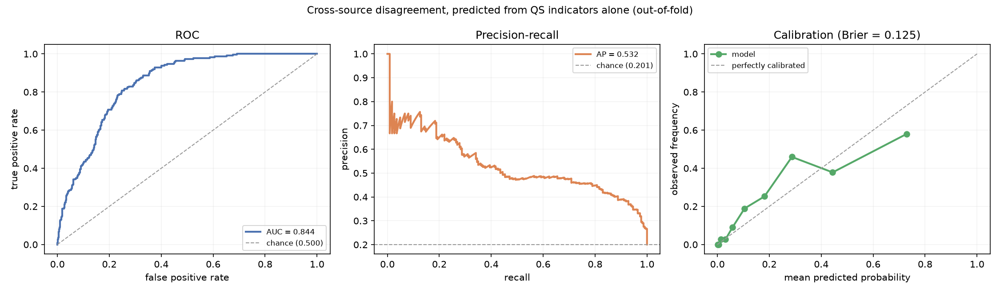

# Model card — cross-source disagreement classifier

**Name** `disagreement` (gradient boosting over QS indicators)
**Version** trained from the QS 2026 (edition-verified, nid 4061771) and THE 2026 crawl snapshots
**Owner** CrawlerNest modelling layer, `crawlernest/crawlernest-ml/`
**Reproduce**
```bash
PYTHONPATH=crawlernest/crawlernest-ml ./.venv/bin/python -m ranking_ml.training.train_disagreement
```

## What it does

Given only what QS published about a university, predicts whether THE will place
it substantially differently.

The use is operational: flag contested institutions at QS ingest time, before
THE data arrives for that university — or at all, since THE covers only part of
what QS ranks.

## The question it deliberately does not ask

The label is derived from both sources' ranks, and each source's rank is close to
a deterministic function of its own published component scores. Phase 2
established that QS's overall score is a weighted sum of its nine indicators to
within 0.0020. A classifier handed *both* sources' scores is therefore not
predicting; it is recomputing a quantity it was given the inputs to, and its
score would be meaningless.

So the modelled task is one-sided: **QS features only**. The two-sided model is
still fitted and reported as a ceiling, so the distance between them is visible.

## Data

| | |
|---|---|
| QS population | 1,504 |
| THE population | 2,191 |
| Matched | **1,136** |
| Match rule | the warehouse's reviewed pairing, falling back to exact normalised name |
| Features | 9 QS indicators |
| Missing | International Faculty Ratio 44, International Student Ratio 19, Sustainability 2 |

Matching is still never fuzzy. A wrong pairing corrupts the label, and on this
data a similarity score pairs Tokyo Institute of Technology with MIT and
University of British Columbia with University of Northern British Columbia.

The pairing is read from `crawlernest-kb/databases/qs_the_pairing_2026.json`,
exported from the warehouse after its entity resolver was seeded with reviewed
aliases and its ambiguous cases were resolved by hand. On the 2026 edition it
places all 1,136 matched universities; exact match on a normalised name alone
would reach 842. `test_pairing_matches_warehouse` confirms the file agrees with
the warehouse's THE 2026 records, and `export_qs_the_pairing.py` reports no
difference.

The two methods were compared on this edition too: on the 830 universities both
place, they choose the same THE entity every time. The pairing adds rows rather
than correcting them, and removes the situation where two independent joins
answered "which institution is this" and nothing checked that they agreed.

Percentiles are computed within each source's **full** population, so a
university's standing means "top x% of what QS ranked", not "top x% of the
overlap".

## Label

`disagreement = |QS percentile − THE percentile| > threshold`, where the
threshold is the 80th percentile of the observed gap — 0.2567, giving 227
positives (20.0%). Stating the positive rate as the design choice, rather than
picking a round cutoff and discovering the rate afterwards, is what makes the
sensitivity analysis below meaningful.

Gap distribution over the 1,136: median 0.112, 75th percentile 0.223, max 0.673.

## Results

Out-of-fold, 5-fold stratified, seed 0:

| Feature set | Model | ROC-AUC | PR-AUC | Brier |
|---|---|---:|---:|---:|
| **QS only** | **gradient boosting** | **0.8488** | **0.5462** | **0.1216** |
| QS only | logistic regression | 0.7526 | 0.3550 | 0.1413 |
| both sources *(ceiling)* | gradient boosting | 0.9260 | 0.7768 | 0.0823 |
| both sources *(ceiling)* | logistic regression | 0.8154 | 0.5609 | 0.1211 |
| chance | — | 0.5000 | 0.1998 | — |



Reading these:

- **PR-AUC 0.546 against a 0.200 base rate** is the honest headline. ROC-AUC
  flatters imbalanced problems; the 2.7× lift in average precision is the part
  that means something operationally.
- **QS alone reaches 0.849 against a two-sided ceiling of 0.926.** Most of what
  is predictable about cross-source disagreement is already visible in QS's own
  numbers. That the ceiling is 0.926 rather than ~0.99 is itself informative:
  THE's published ranks are heavily tied at the tail, which caps how
  deterministic the label can be.
- **Gradient boosting beats logistic regression by a wide margin** (0.849 vs
  0.753). Worth contrasting with the overall-score model, where trees lost badly
  to a linear fit. There the relationship was exactly linear; here it is not.
- **Calibration is close in the lowest bins, under-confident around a predicted
  0.3 and over-confident at the top**: the bin near 0.30 has an observed
  frequency of 0.42, and the highest-probability bin predicts 0.74 where the
  observed frequency is 0.62. Any threshold placed in those regions should
  account for it.

### Threshold sensitivity

| Gap threshold | Positive rate | ROC-AUC | PR-AUC |
|---:|---:|---:|---:|
| 0.1925 (q=0.70) | 30.0% | 0.8500 | 0.6555 |
| 0.2567 (q=0.80) | 20.0% | 0.8488 | 0.5462 |
| 0.3312 (q=0.90) | 10.0% | 0.8185 | 0.3102 |

The result survives the choice of cutoff between the 70th and 80th percentile
(ROC-AUC 0.850 and 0.849) and weakens at the 90th (0.819), where only 114 pairs
are positive. PR-AUC falls with the base rate, as it must, while its lift over
chance grows from 2.2× to 3.1×. Whether the drop at q=0.90 is the model ranking
the most extreme disagreements worse or fold-to-fold noise on 114 positives was
not tested. The previous committed numbers had it flat (0.836–0.841); the 2026-09-21
refresh is what moved it, which is a reminder of how little ~110 positives pin down.

### Against the previous committed numbers

The metrics file committed before this one (ROC-AUC 0.8662, PR-AUC 0.5922 on
1,104 matched) was trained on the QS **2027** table, which had been saved as the
2026 snapshot. The metrics gate refused the comparison on the invariant change
(`matched` 1,104 → 1,109, `positives` 221 → 222), which is what it is for. The
lower numbers above describe a different edition, not a regression in the code:
the model, features and pairing rule are unchanged.

The numbers in this card were then recommitted on 2026-10-03 after the weekly
refresh of 2026-09-21 (a new THE crawl and a re-exported pairing) moved `matched`
1,109 → 1,112 and `positives` 222 → 223 without anyone regenerating them; the gate's
invariants and the MATLAB parity check had both been failing since. ROC-AUC for the
QS-only boosted model moved 0.8384 → 0.8437. The largest gap in the old dataset,
0.738, was a false pair (QS's Miami University in Ohio joined to THE's University of
Miami through a merged canonical), which the entity split of 2026-10-03 removed.

They were recommitted again on 2026-10-19, after the duplicate-canonical merge of
2026-10-12 put a QS rank and a THE rank that had sat on two records of one university
onto one: `matched` 1,112 → 1,136, `positives` 223 → 227, QS-only boosted ROC-AUC
0.8437 → 0.8488. The pre-push warehouse drift check caught the stale pairing.

### Asymmetry

Among the 227 disagreeing pairs, **THE ranks the university higher in 180 cases
and QS in 47** — roughly 4 to 1. The two sources do not merely differ; they
differ in a consistent direction, which is a finding about the sources rather
than about the model.

## Research loop (2026-11-11)

`ranking_ml/research/disagreement.py` runs the same propose -> run -> judge loop as the overall-score model over a
whitelisted space: model (gradient boosting, logistic, random forest) x missing values (median, knn) x class weighting
(none, balanced), 10 valid specs. Features stay the nine QS indicators. The 1,136 matched universities are split once
into search (852, 171 positive) and holdout (284, 57 positive), and the label threshold (0.2566) is taken from the
search rows. Decisions use out-of-fold PR-AUC on the search rows, with a minimum gain of 0.005.

| Spec | Search PR-AUC | Holdout PR-AUC | Holdout ROC-AUC | Holdout Brier |
|---|---:|---:|---:|---:|
| gradient_boosting, median, none *(committed model)* | 0.5528 | 0.5549 | 0.8396 | 0.1303 |
| **random_forest, median, none** *(best)* | **0.6003** | **0.5663** | **0.8616** | **0.1162** |
| chance | 0.20 | 0.2007 | 0.5 | — |

The search margin (+0.048) mostly does not survive to the holdout (+0.011 PR-AUC, +0.022 ROC-AUC). The best node was
chosen among 10 trials on the same search rows, so its search margin is optimistic by construction. Whether +0.011
on 57 holdout positives is more than noise was not tested; testing it would be another read of the holdout. The
committed model is therefore **unchanged**. A switch to random forest would rest on a fresh holdout (the next THE and
QS editions), not this one, which the ledger shows as read once.

Logistic regression trails by about 0.25 PR-AUC with or without class weighting, the same gap the committed metrics
show. Balanced class weights moved random forest by +0.003 (below the threshold) and did not help logistic.

## Known limitations

- **Single edition.** Nothing here is temporal.
- **Still an incomplete overlap.** 1,136 of a possible 1,504. The 368 absent
  universities are the ones THE does not rank, or whose pairing has not been
  reviewed, and the second group is plausibly also more likely to be treated
  differently by the two sources — so the sample may be biased toward easier
  cases.
- **Label is a discretised continuum.** Disagreement is a matter of degree;
  thresholding it loses information. The sensitivity table is the mitigation,
  not a fix.
- **THE rank ties.** THE caps its tail at rank 1501 with many ties, which makes
  percentiles in that region coarse.
- **Over-confidence at the top of the probability range**, as above.
- **Not causal.** The model says which QS profiles tend to accompany
  disagreement, not why the sources disagree.

## Intended use

Flagging candidates for review in the cross-source disagreement analytics the
platform already surfaces. Output is a probability, not a verdict, and any
surfaced use must carry a `caveats` entry saying so. It must not be used to
adjust, reweight, or override either source's published rank.
